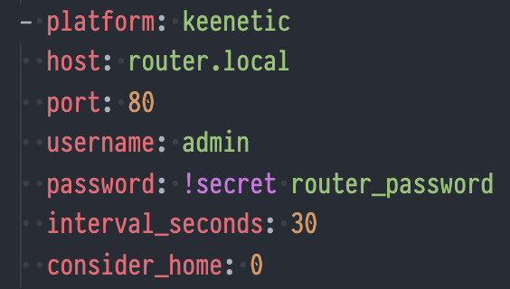
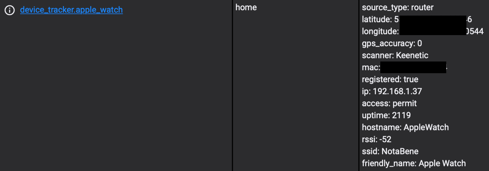
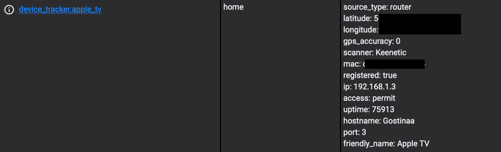

# Keenetic Device Tracker

[](https://github.com/hacs/integration)

Home Assistant [device_tracker](https://www.home-assistant.io/integrations/device_tracker/) integration for Keenetic routers.

## Features

- 🔄 **Async architecture** - Non-blocking HTTP requests using httpx
- 🔐 **SSL/HTTPS support** - Secure connection to your router
- 🔁 **Automatic retry** - Exponential backoff on connection failures (3 attempts)
- 🖥️ **UI Configuration** - Easy setup through Home Assistant UI (config flow)
- 📡 **Device tracking** - Track all connected devices (wireless and wired)
- 📊 **Rich attributes** - SSID, RSSI, port, speed, uptime, and more

## Installation

### HACS (Recommended)

1. Open HACS in Home Assistant
2. Go to "Integrations"
3. Click the three dots menu → "Custom repositories"
4. Add `https://github.com/notabene00/HA-Keenetic-device_tracker` with category "Integration"
5. Click "Install"
6. Restart Home Assistant

### Manual Installation

1. Copy the `custom_components/keenetic` folder to your Home Assistant `custom_components` directory
2. Restart Home Assistant

## Configuration

### UI Configuration (Recommended)

1. Go to **Settings** → **Devices & Services**
2. Click **+ Add Integration**
3. Search for "Keenetic"
4. Enter your router details:
   - **Host**: Router IP address (default: `192.168.1.1`)
   - **Username**: Router admin username (default: `admin`)
   - **Password**: Router admin password
   - **Port**: Custom port (optional)
   - **Use SSL**: Enable HTTPS connection
   - **Verify SSL**: Verify SSL certificate (disable for self-signed)

### Device Attributes

#### Wireless Devices
| Attribute | Description |
|-----------|-------------|
| `mac` | MAC address |
| `ip` | IP address |
| `hostname` | Device hostname |
| `ssid` | Connected WiFi network |
| `rssi` | Signal strength (dBm) |
| `uptime` | Connection uptime |
| `connection_type` | `wireless` |

#### Wired Devices
| Attribute | Description |
|-----------|-------------|
| `mac` | MAC address |
| `ip` | IP address |
| `hostname` | Device hostname |
| `port` | Switch port number |
| `speed` | Link speed (Mbps) |
| `duplex` | Duplex mode |
| `uptime` | Connection uptime |
| `connection_type` | `wired` |

## Screenshots

### Configuration


### Wireless Clients


### Wired Clients


## Requirements

- Home Assistant 2023.1 or newer
- Keenetic router with web interface enabled
- Router admin credentials

## Troubleshooting

### Cannot connect to router
- Verify the router IP address is correct
- Ensure the router web interface is accessible
- Check if the port is correct (80 for HTTP, 443 for HTTPS)

### Authentication failed
- Verify username and password
- Ensure the user has admin privileges

### SSL certificate errors
- For self-signed certificates, disable "Verify SSL" option
- Or install a valid SSL certificate on your router

## Development

```bash
# Install dependencies
pip install -e ".[dev]"

# Run tests
pytest

# Run tests with coverage
pytest --cov=custom_components/keenetic
```

## License

MIT License

## Credits

- Original author: [@fantomnotabene](https://github.com/fantomnotabene)